<picture><source media="(prefers-color-scheme: dark)" srcset="assets/hero-dark.svg"></picture>

<a href="https://github.com/staticSomnia/nix-dots"><picture><source media="(prefers-color-scheme: dark)" srcset="assets/project-nix-dots-dark.svg"></picture></a>&nbsp;<a href="https://github.com/staticSomnia/walls"><picture><source media="(prefers-color-scheme: dark)" srcset="assets/project-walls-dark.svg"></picture></a>

<picture><source media="(prefers-color-scheme: dark)" srcset="assets/wave-dark.svg"></picture>

<a href="https://metawka.github.io/expressive-profile/?from=staticSomnia"><picture><source media="(prefers-color-scheme: dark)" srcset="assets/credit-dark.svg"></picture></a>

